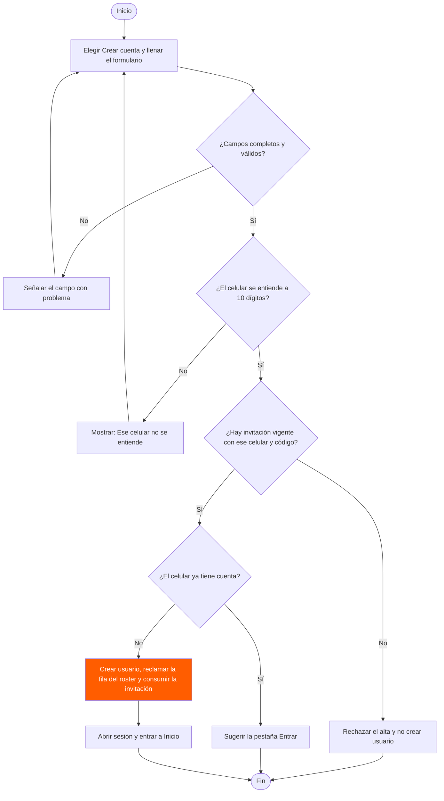
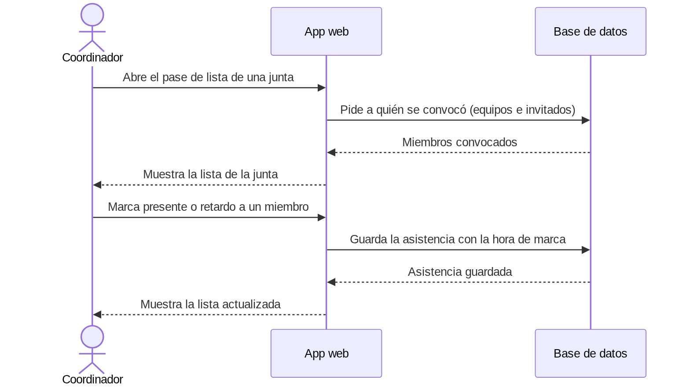
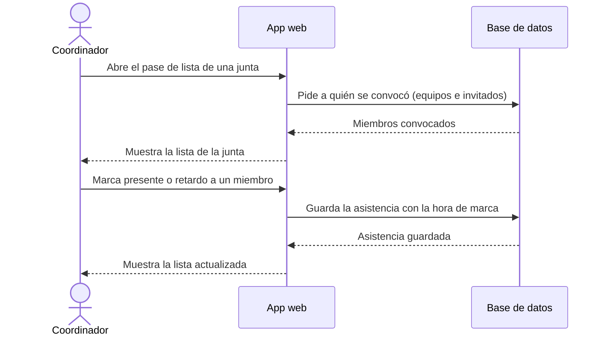
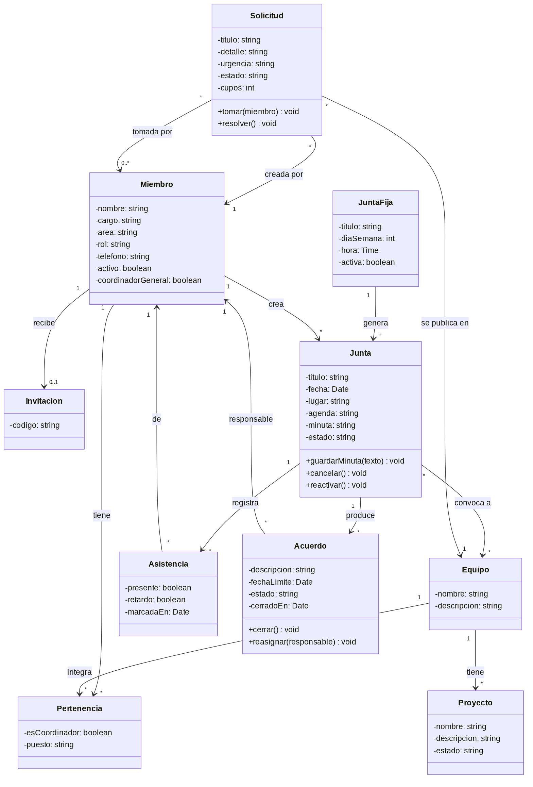
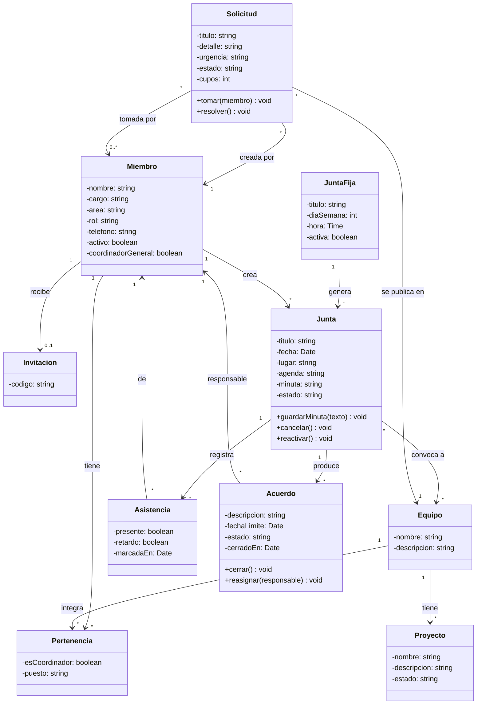
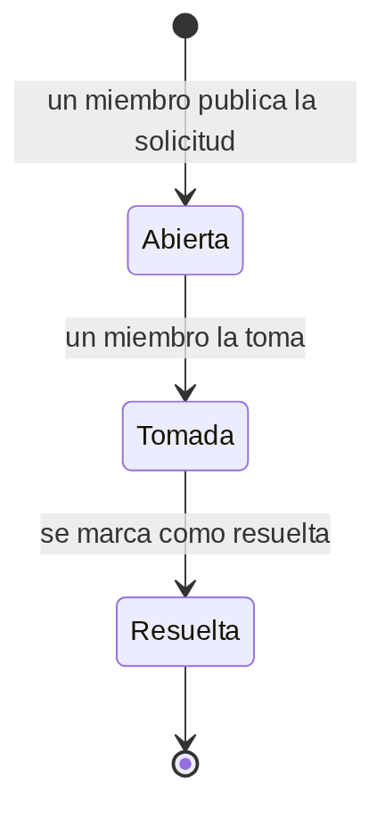
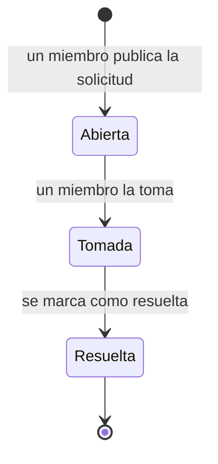
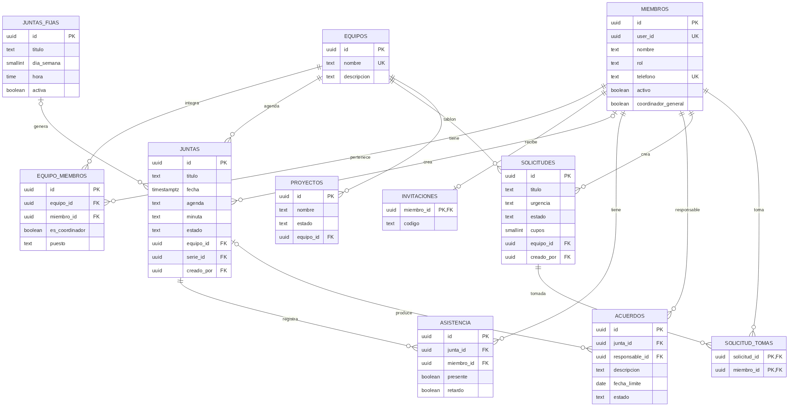
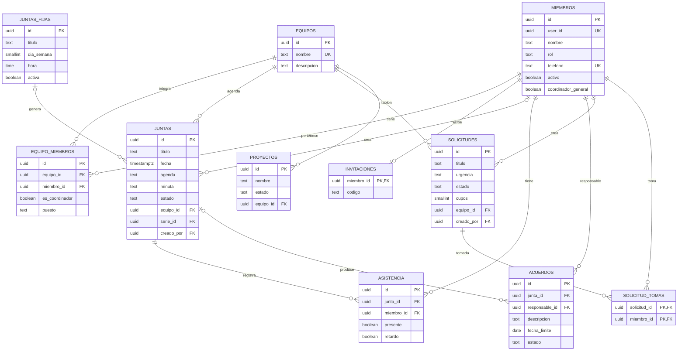

# Cinco ejemplos para practicar — Fresales

Ingeniería de Software I · SIS3407 · Unidad 3, diseño de software.
Sistema modelado: **Fresales**, el sistema interno de la mesa directiva de FESAL
(módulo piloto de PGI), desplegado en https://fesal-interno.pages.dev.

Los diagramas se entregan como **texto de Mermaid**, junto con una imagen de cada uno.
GitHub dibuja el código al abrir este archivo. Para ver uno en el editor, pégalo en
https://mermaid.live. La numeración (4 a 8) es la de la guía rápida de Mermaid.

## De dónde sale cada dato

- **Requisitos y casos de uso:** [especificación de requisitos](../../docs/especificacion-requisitos.md)
  (v1.1) y [CU-01](../../docs/diagramas/CU-01-crear-cuenta.md).
- **Estructura de datos:** el esquema real de la base de datos de Fresales (Supabase,
  esquema `public`), consultado en modo lectura el 27-oct-2026. Solo se leyó la
  estructura de las tablas, no sus datos.

## 4 · Diagrama de flujo con decisiones

CU-01, crear cuenta con código de invitación, con sus flujos alternos A1 a A4.

Código Mermaid:

## 5 · Diagrama de secuencia

Cómo se pasan los mensajes entre piezas al tomar la asistencia de una junta.

Código Mermaid:

## 6 · Diagrama de clases

Atributos, métodos y multiplicidad de las entidades principales. Los métodos salen de los requisitos RF-06 a RF-20 y de los eventos del sistema.

Código Mermaid:

## 7 · Diagrama de estados

Ciclo de vida de una solicitud de ayuda entre equipos (RF-11, RF-17 y RF-18).

Código Mermaid:

## 8 · Diagrama entidad-relación

Las tablas principales de la base de datos de Fresales y cómo se relacionan. No se dibuja la relación de miembros con el usuario de autenticación.

Código Mermaid:

## Notas y diferencias con la especificación

- **Tablas que no se dibujan.** Los diagramas 6 y 8 incluyen solo las entidades necesarias
  para estos ejemplos. Quedaron fuera `canales`, `mensajes`, `archivos`, `carpetas_drive`,
  `avisos`, `confirmaciones`, `horarios`, `semestres`, `reglamento_firmas`, `patros`,
  `suscripciones_push` y `eventos_push`, además de las tablas de unión de juntas y avisos.
- **Estados de la junta.** La especificación v1.1 habla de junta "propuesta" y "confirmada"
  (RF-05, RF-06). En la base de datos actual el estado de una junta es `confirmada` o
  `cancelada`, y existe `juntas_fijas` para juntas recurrentes. Por eso la clase `Junta`
  tiene `cancelar()` y `reactivar()`.
- **Solicitudes con varios cupos.** La tabla `solicitudes` tiene `cupos` y la tabla
  `solicitud_tomas` registra a cada miembro que la toma. El diagrama de estados muestra
  solo el ciclo abierta, tomada y resuelta de la especificación. Cuándo pasa a "tomada"
  cuando hay más de un cupo no se puede ver en el esquema.
- **Roles.** La base acepta `coordinador`, `miembro` y `asesor`; la especificación solo
  describe Miembro y Coordinador.
