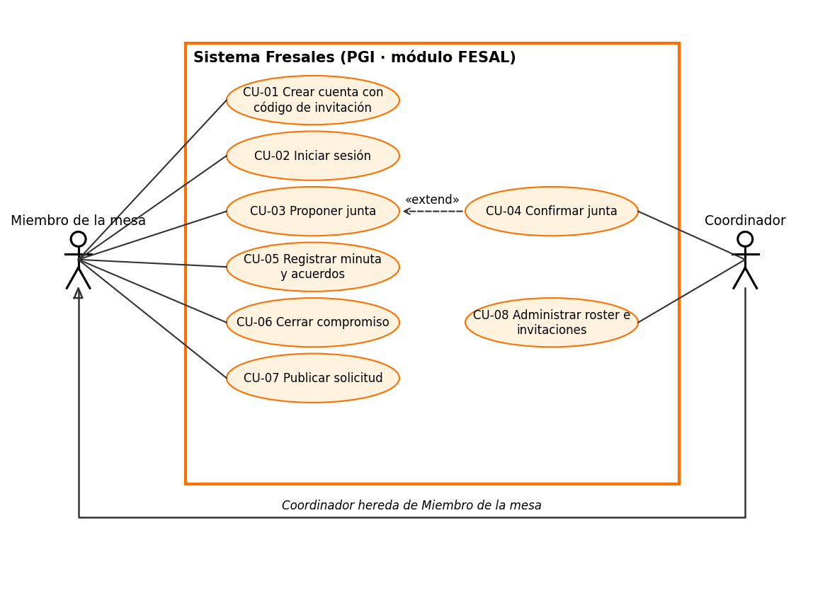

# CU-01 — Crear cuenta con código de invitación

Diagrama editable: [casos-de-uso.drawio](casos-de-uso.drawio).

| Campo | Descripción |
|---|---|
| **ID / Nombre** | CU-01 · Crear cuenta con código de invitación |
| **Actor principal** | Miembro de la mesa directiva (aún sin cuenta) |
| **Actores secundarios** | Coordinador (emitió la invitación antes del caso, ver CU-08); Servicio de autenticación (Supabase Auth) |
| **Objetivo** | Que un miembro del roster cerrado reclame su fila y obtenga acceso a Fresales con celular y contraseña. |
| **Alcance** | Sistema Fresales (módulo FESAL de PGI) |
| **Nivel** | Objetivo de usuario |

## Precondiciones
1. El miembro figura en el roster de la mesa y el coordinador ya registró su celular.
2. Existe una invitación vigente para esa fila; el coordinador le entregó el código por fuera del sistema (WhatsApp, en persona).
3. El miembro aún no tiene cuenta.
4. El miembro tiene el sistema abierto en la pantalla de acceso (`/login`).

## Postcondiciones
- **Éxito:** se crea el usuario de autenticación, queda ligado a su fila del roster, la invitación se consume (el código deja de servir) y el miembro entra a Inicio. El nombre o apodo que escribió reemplaza el que puso el coordinador.
- **Fallo:** no se crea cuenta ni se toca el roster; la invitación sigue vigente (el alta es atómica).

## Disparador
El miembro elige la pestaña **Crear cuenta** en la pantalla de acceso.

## Flujo principal
1. El miembro abre la pantalla de acceso y selecciona **Crear cuenta**.
2. El sistema muestra los campos: nombre o apodo, celular, contraseña y código de invitación.
3. El miembro escribe su nombre o apodo (2–60 caracteres), su celular, una contraseña (mínimo 8 caracteres) y el código que le dio el coordinador.
4. El miembro pulsa **Crear cuenta**.
5. El sistema normaliza el celular a formato internacional (10 dígitos → `+52…`) y deshabilita el formulario mientras envía.
6. El servicio de autenticación recibe el alta y el sistema verifica que el celular y el código coincidan con una invitación vigente del roster.
7. El sistema reclama la fila del roster para el nuevo usuario, reemplaza el nombre con el apodo escrito y elimina la invitación.
8. Se abre la sesión y el sistema redirige al destino guardado si está permitido, o a Inicio (Mesa directiva).

## Flujos alternos
**A1 — El celular no se entiende** (paso 5)
1. El sistema no logra normalizar el celular (no son 10 dígitos válidos).
2. Muestra: "Ese celular no se entiende. Escríbelo a 10 dígitos, como 4421234567." No envía nada.
3. Vuelve al paso 3 con los datos conservados.

**A2 — Falta o sobra algún dato** (paso 4)
1. El navegador detecta un campo obligatorio vacío, un nombre fuera de 2–60 caracteres o una contraseña de menos de 8 caracteres.
2. Señala el campo y no envía el formulario. Vuelve al paso 3.

**A3 — Celular sin invitación o código incorrecto** (paso 6)
1. La verificación no encuentra invitación vigente que coincida con celular y código.
2. La base rechaza el alta (no se crea ningún usuario) y el sistema muestra: "Ese celular no tiene invitación o el código no coincide. Pídeselo a un coordinador."
3. El miembro corrige el código (regresa al paso 3) o contacta al coordinador para que emita una nueva (CU-08).

**A4 — El celular ya tiene cuenta** (paso 6)
1. El servicio de autenticación indica que el celular ya está registrado.
2. El sistema muestra un error genérico de creación y sugiere revisar los datos.
3. El miembro cambia a la pestaña **Entrar** y continúa en CU-02.

**A5 — Falla el servicio o la red** (pasos 5–7)
1. El envío falla por red o por caída del servicio.
2. El sistema muestra: "No se pudo crear la cuenta. Revisa los datos e intenta de nuevo." y rehabilita el formulario.
3. Como el alta es una sola operación (si algo falla, no se crea la cuenta ni se consume la invitación), el miembro reintenta desde el paso 4 con el mismo código.

**A6 — El coordinador reemitió la invitación** (paso 6)
1. El coordinador generó un código nuevo (CU-08) y el miembro usa el anterior.
2. El sistema rechaza el alta como en A3.
3. El miembro pide el código vigente al coordinador y regresa al paso 3.

**A7 — La fila ya fue reclamada o el celular del roster cambió** (paso 6)
1. Otra persona reclamó la fila antes, o el coordinador corrigió el celular de la fila.
2. El sistema rechaza el alta como en A3.
3. El miembro contacta al coordinador; no avanza hasta que el roster y su celular coincidan.

> Los miembros con cuenta anterior por correo no usan este caso: entran con CU-02.

## Reglas de negocio
- **RN-CU01-1 Roster cerrado:** sólo puede darse de alta quien ya está en el roster con invitación; no existe registro abierto.
- **RN-CU01-2 Código de un solo uso:** la invitación se elimina al reclamarse; el código sólo lo puede leer el coordinador.
- **RN-CU01-3 Sin confirmación por SMS:** por eso el código es indispensable: sin él, conocer el celular de alguien no basta para tomar su fila.
- **RN-CU01-4 Nombre propio:** el nombre escrito por el miembro prevalece sobre el del coordinador.
- **RN-CU01-5 Un celular, una cuenta.**

## Requisitos especiales
- Debe funcionar en celular (la mesa entra desde iPhone instalado como app).
- Contraseña mínima de 8 caracteres.

## Frecuencia de uso
Una vez por miembro; en ráfaga al inicio de cada periodo, cuando se renueva la mesa.

## Requisitos que realiza
Ver [`especificacion-requisitos.md`](../especificacion-requisitos.md).
- **RF-01** Crear cuenta con código de invitación (flujo principal).
- **RF-02** Rechazar el alta sin invitación vigente (A3).
- **RF-03** Consumir la invitación al usarse (paso 7; A4 y A5 si ya se consumió).
- **RF-14** Emitir una invitación (precondición 2, CU-08).
- **RNF-01** Seguridad: sin invitación no se toma una fila (RN-1, RN-3).
- **RNF-02** Contraseña de 8 o más caracteres (A2).
- **RNF-06** Usabilidad: alta en ≤ 2 minutos desde el celular.
